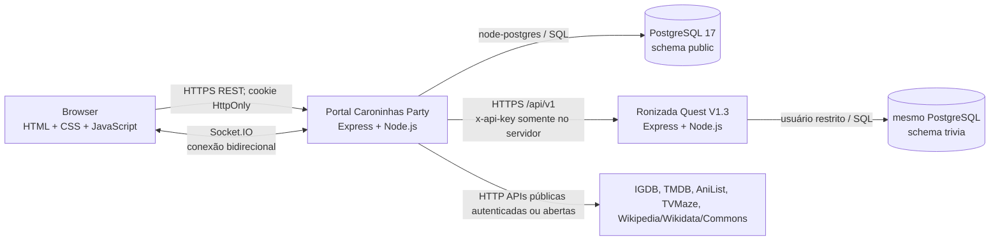

# 01 — ARQUITETURA, STACK, INFRAESTRUTURA E DEPLOY

## 1. Visão de contexto

Arquitetura de **dois serviços Node.js + PostgreSQL**, com o navegador abrindo uma aplicação monolítica renderizada por HTML/CSS/JS puro e usando WebSockets via Socket.IO para partidas. O portal é o **único frontend**. Para a Corrida, seu backend consulta a **API de perguntas separada** pela rede; o navegador não se autentica diretamente na Trivia API.



**Observação:** `P` e `Q` representam **schemas lógicos** do PostgreSQL informado no histórico do projeto; não são necessariamente servidores físicos diferentes. A topologia exata da Discloud deve ser verificada no painel da hospedagem.

## 2. Tecnologias confirmadas pelo código

| Camada | Tecnologia | Arquivos evidência | Notas |
|---|---|---|---|
| Frontend | HTML5 sem framework SPA | `public/index.html` | Diversas `<section class="screen">`, visibilidade por classe `.hidden` |
| Estilo | CSS3 puro | `public/style.css` | Variáveis CSS, Flexbox, Grid, queries de responsividade, estados, animações |
| Cliente | JavaScript vanilla | `public/script.js` | Manipulação do DOM, estado em objetos JS, `localStorage`, `sessionStorage`, `fetch`, Socket.IO |
| Tempo real | Socket.IO 4.8.x | `server.js` + cliente | Salas, broadcast, callbacks, reconexão |
| HTTP | Express 5.2.x | `server.js`, `auth.js` | Static SPA, endpoints JSON e perfis |
| Runtime | Node.js | `package.json` | Portal necessita `fetch` e `AbortSignal.timeout` nativos: usar Node >= 20 por segurança operacional |
| Persistência | PostgreSQL + `pg` 8.13.x | `db.js`, SQL | Pools de até 10 conexões no portal |
| Ambiente | `dotenv` 16.4.x | `db.js`, app Trivia | Credenciais por variáveis de ambiente |
| API Trivia | Express 5.2.x + Node >=20 | `trivia/src/*` | Resposta individual com carimbo temporal no banco |
| Criptografia | `node:crypto` | `auth.js`, `server.js`, `trivia-race.js` | scrypt, SHA-256, segredo aleatório, randomUUID, comparação segura |
| Testes | `node:test` | `tests/*.test.js` | Testes de regras, handlers, compatibilidade e checagem estática |
| Hospedagem | Discloud (arquivos `discloud.config`) | Ambos pacotes | Dois apps Node, conexão com PostgreSQL privado via VLAN quando exigida |

**Não há evidência de React, Vue, Angular, Vite, TypeScript, Tailwind, Next.js, Django ou gRPC neste site**. Não introduzir frameworks numa réplica estrita, a menos que se aceite reescrever o produto mantendo seus contratos.

## 3. Estrutura do portal e responsabilidades

```text
caroninhas-party/
├── server.js                      # Express, HTTP, Socket.IO, salas, Impostor, Quem Sou Eu?
├── trivia-race.js                 # Corrida: filtros, estados, REST de perguntas, pontuação
├── auth.js                        # Usuários, sessões, cookies, perfis, stats, preferências
├── db.js                          # Pool pg + query + testConnection
├── whoami-images.js               # Provedores externos de imagens e fallback
├── public/
│   ├── index.html                 # TODAS as telas, modais, templates e SVG sprite
│   ├── script.js                  # SPA, eventos, sockets, modais, timers, telas
│   ├── style.css                  # Design system e regras específicas de cada tela
│   ├── caroninhas-party-banner.png
│   └── avatars/                   # 10 animais PNG
├── database/
│   ├── schema.sql                 # schema principal
│   ├── seed.sql                   # categorias, níveis e conteúdo-semente
│   ├── migrations/001..005.sql    # contas, quiz legado, preferências, expansão do acervo
│   └── data/quiz_questions.jsonl  # acervo local legado (não confundir com Ronizada)
├── scripts/
│   ├── bootstrap-db.js
│   ├── init-db.js
│   ├── run-migrations.js
│   ├── load-quiz-questions.js
│   └── whoami-image-report.js
├── tests/                         # testes Node
├── package.json / package-lock.json
├── discloud.config                # IMPORTANTE: versão de teste no ZIP analisado
└── .env.example                   # placeholders; não tem credenciais reais
```

Principais decisões arquiteturais: **monólito pequeno para site + API dedicada para perguntas**; separação funcional do código da Corrida em `trivia-race.js`; provedores de imagem encapsulados em `whoami-images.js`; autenticação encapsulada em `auth.js`; nenhum bundler exigido para browser.

## 4. Estrutura da Ronizada Quest

```text
ronizada-quest/
├── index.js                         # entrada principal
├── src/server.js                    # bootstrap HTTP, proteção de ambiente e encerramento
├── src/app.js                       # rotas JSON e operações SQL
├── src/db.js                        # pool PostgreSQL
├── src/bootstrap.js                 # migração/importação condicionais
├── src/config.js                    # exigência de segredos
├── src/rounds.js                    # IDs, prazos e respostas
├── src/normalize.js                 # alternativas/sorteio/normalização
├── src/validation.js                # filtro e validação de requisição
├── src/importer.js                  # importação do JSONL
├── sql/001_init.sql                 # trivia.questions, rounds, round_answers
├── sql/000_PREPARAR_SCHEMA_E_USUARIO.sql # preparação administrativa UMA VEZ
├── scripts/migrate.js, import.js, bootstrap.js
├── data/questions.jsonl             # acervo de perguntas PT-BR
├── tests/
├── discloud.config / .env.example
└── package.json
```

## 5. Modelo de hospedagem

- **Portal de produção observado no histórico:** `https://caroninhas-party.discloud.dev`.
- **API Trivia:** `https://ronizada-quest.discloud.dev`, com verificação `/health` retornando versão `1.3.0` em teste anterior.
- **Bancos:** ambos usam PostgreSQL; Trivia limitada ao schema `trivia` e usuário com privilégios restritos. Histórico cita host privado e VLAN. Os detalhes de credenciais e host privado não estão reproduzidos deliberadamente.
- **Portal:** `discloud.config` do ZIP analisado usa `TYPE=site`, `MAIN=server.js`, `START=npm start`, `RAM=512`, `AUTORESTART=true`, `VLAN=true`, mas o **ID/hostname são de teste**. A configuração de produção precisa ser obtida da aplicação original, não inferida daqui.
- **API:** também usa app Discloud distinto `ronizada-quest`, com VLAN necessária ao acesso ao banco privado no cenário histórico.
- **Exposição externa:** HTTP/HTTPS pela plataforma; cliente se conecta ao Socket.IO no mesmo host da aplicação principal. Portas locais padrão `8080` para site/API e `5432` para PostgreSQL.

## 6. Inicialização do backend

No portal, `startServer()` (fim de `server.js`) valida conexão com PostgreSQL, executa `bootstrapDatabase` apenas quando `AUTO_INIT_DB === "true"`, executa `runMigrations`, importa acervo legado por `loadQuizQuestions` e inicia o servidor HTTP. **Mesmo com AUTO_INIT_DB=false, existem tarefas de banco na inicialização**. Nunca usar uma base de produção como ambiente de teste sem backup.

Na Trivia, `src/server.js` valida `TRIVIA_API_KEY`, `TRIVIA_ADMIN_KEY` e credenciais, aguarda o banco, chama `initializeDatabase` (migração e importação condicional) e inicia o Express; `AUTO_IMPORT=if_empty` protege contra reimportação do acervo não vazio.

## 7. Estado em memória e consequência operacional

As salas do portal são mantidas em `rooms = new Map()`; os temporizadores de desconexão também em memória. `trivia-race.js` mantém `race = new Map()`, `setTimeout` de prazo e transição. Isso significa:

1. Restart/redeploy do portal **interrompe salas e partidas**, mesmo que os usuários continuem registrados no banco.
2. Os dados de conta, sessão e histórico registrados no PostgreSQL sobrevivem ao restart.
3. Rodadas e respostas da Trivia que já chegaram ao schema `trivia` podem sobreviver ao restart da API; mas **o estado da Corrida e a sala** são propriedade do portal e não se reconstituem automaticamente só com o banco.
4. Rodar múltiplas réplicas do portal sem sticky sessions/adapter Socket.IO compartilhado poderá quebrar a consistência. Esse sistema não declara Redis adapter nem persistência distribuída.

## 8. Dependências externas e risco

- **Twitch/IGDB:** client credential flow e consulta de imagens para personagens/jogos.
- **TMDB:** imagens de atores/personagens de filmes.
- **AniList:** GraphQL para anime/mangá.
- **TVMaze:** APIs de elenco/personagens.
- **Wikipedia/Wikidata/Wikimedia Commons:** descoberta/atribuição de imagens.
- **Google Fonts:** carrega `Chakra Petch` e `Nunito` pela rede no `public/index.html`.
- **Open Trivia Database:** proveniência original de questões na Ronizada Quest, sujeito a atribuição CC BY-SA 4.0.

Fallbacks e prioridades variam por categoria: inspecionar `whoami-images.js` para reproduzir o comportamento por provedor. Falha do provedor externo **não** deve impedir os outros minijogos de serem exibidos.

## 9. Runtime/deploy recomendado para reprodução

```bash
# ambiente de desenvolvimento separado para portal
npm ci
npm test
node --check public/script.js
npm start

# em ambiente isolado, executar API separada
npm ci
npm test
npm start
```

Use banco de teste e `.env` individual para cada serviço. Não automatize troca de ID de aplicação, senha ou esquema SQL sem revisar `discloud.config`. Os arquivos podem conter dados licenciados/terceiros que exigem atribuição.
