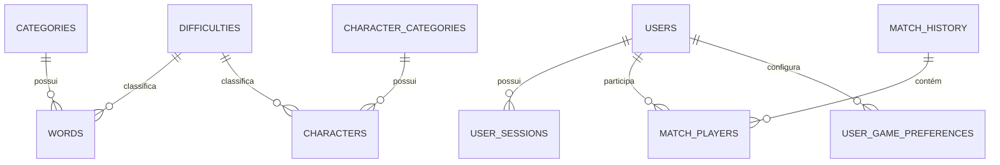
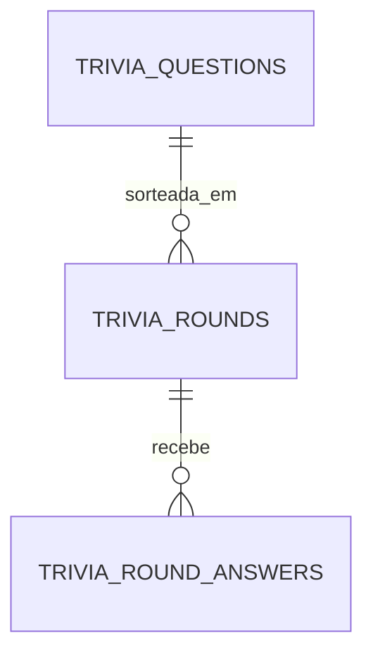

# 02 — MODELAGEM DE DADOS, SQL, ESTADOS E PERSISTÊNCIA

## 1. Separação lógica

O mesmo PostgreSQL da implantação histórica mantém **duas áreas isoladas**: `public` para Caroninhas Party e `trivia` para Ronizada Quest. O portal consulta `public` diretamente por `pg`; a Trivia API usa conexão e permissão restritas no schema `trivia`. **Não confundir `public.quiz_questions` (recurso legado) com `trivia.questions` (acervo atual da Corrida).**

## 2. Modelo principal (`database/schema.sql` + migrações)

| Tabela | PK | Principais campos / FKs | Uso |
|---|---|---|---|
| `categories` | `id SERIAL` | `name`, `slug`, `emoji`, `display_order`, `active` | Categorias de palavras do Impostor |
| `difficulties` | `id SMALLSERIAL` | `name`, `slug`, `level` ∈ [1,3] | Níveis usados por palavras e personagens |
| `words` | `id BIGSERIAL` | `word`, `hint`, `category_id → categories`, `difficulty_id → difficulties`, `active`, `times_used` | Sorteio Impostor; `(word,category_id)` único |
| `character_categories` | `id SERIAL` | campos semelhantes às categorias de palavras | Filtros Quem Sou Eu? |
| `characters` | `id BIGSERIAL` | `name`, `image_url`, `category_id → character_categories`, `difficulty_id → difficulties`, `times_used` | Acervo Quem Sou Eu?; `(name,category_id)` único |
| `users` | `id BIGSERIAL` | `nickname`, `nickname_key` único, `password_hash`, `birth_date`, `avatar_type`, `avatar_id`, `profile_image BYTEA`, MIME | Conta e foto de perfil |
| `user_sessions` | `token_hash CHAR(64)` | `user_id → users`, `expires_at`, `last_seen_at` | Sessões persistentes em cookie |
| `match_history` | `id BIGSERIAL` | `round_key` único, `game_type`, `room_code`, `winner_user_id`, `winner_side`, `result_reason` | Histórico de partidas computadas |
| `match_players` | `(match_id,user_id)` | `game_type`, `won`, `role`, `eliminated`, `attempts_used`, `character_name` | Estatísticas por usuário |
| `user_game_preferences` | ver migração 004 | `user_id`, `game_type`, `preferences` | Preferências salvas por modalidade |
| `quiz_questions`, `quiz_match_players` | ver migração 002 | pergunta, filtros e associação de jogador | Esquema legado de Quiz e Caos — não é fonte da nova Corrida |

As migrações incluem `001_v19_accounts.sql`, `002_quiz_caos.sql`, `003_quiz_pawns.sql`, `004_game_preferences.sql`, `005_whoami_expansion_1008.sql`. A última expande o acervo de personagens. O histórico do projeto menciona **1.224 personagens** na operação, mas o número atual deve ser verificado no PostgreSQL porque conteúdo `seed.sql`/migrações e base viva podem divergir.

### ER simplificado



## 3. Detalhes de modelagem importantes

- `users.nickname_key` normaliza nickname por NFKC + minúsculas pt-BR; é único. `nickname` guarda a grafia mostrada.
- `profile_image` é BYTEA no PostgreSQL, com tipo MIME em coluna separada. Foto não é uma URL arbitrária no cadastro da conta.
- Trigger `set_updated_at()` renova `updated_at` em `words`, `characters`, `users`; migrações criam índices para consultas de categoria/dificuldade e histórico.
- `user_sessions` armazena **hash SHA-256 do token de cookie**, não o token puro.
- Histórico de partida é único por `round_key` e associado a jogadores autenticados; visitantes sem conta não têm linha `users` correspondente.
- `getStats()` do código de referência considera os tipos **`impostor` e `whoami`**. Não afirmar que o progresso da Corrida já integra estatísticas de conta. A Corrida usa pontos efêmeros no servidor.

## 4. Schema `trivia` — implementação V1.3

| Tabela | Campos estruturais | Invariantes |
|---|---|---|
| `trivia.questions` | `id TEXT`, pergunta PT/EN, alternativas PT/EN JSONB, gabarito PT/EN, `review_status`, `source_review_status`, `category_pt`, `difficulty`, `question_type`, `content_hash`, `original_record` | só `review_status='approved'` entra no sorteio; `difficulty∈{easy,medium,hard}`, `question_type∈{multiple,boolean}` |
| `trivia.rounds` | `id UUID`, `room_id TEXT`, `question_id FK`, `shuffled_options JSONB`, `correct_option_id`, `duration_seconds`, `started_at`, `finished_at` | `UNIQUE(room_id,question_id)`; `duration_seconds ∈ [0,30]` |
| `trivia.round_answers` | `(round_id UUID,player_id TEXT)` PK, `option_id`, `received_at` | uma resposta por jogador/rodada; opção A-D; timestamp registrado pelo banco |



**Nota sobre o acervo:** existem 5.247 perguntas na importação da API, e um teste operacional anterior mostrou 5.046 em `approved`, 106 em `blocked` e 95 em `rejected`. As **5.046 foram aprovadas em lote para testes, sem revisão factual individual**. Esses totais são um retrato histórico, não uma consulta em tempo real. A cópia exata depende do dataset `data/questions.jsonl` e/ou exportação da tabela (sem dados pessoais).

## 5. Isolamento e permissões

- A API utiliza papel dedicado com permissões sobre `trivia`, historicamente `caroninhas_trivia_api`.
- O portal utiliza sua própria credencial de banco. **Jamais reutilize credencial privilegiada do portal no container Trivia.**
- Criação da role/schema exigiu preparação administrativa uma vez só, fora do bootstrap normal.
- A migração V1.3 cria `trivia.round_answers` de forma aditiva. `public` e as 5.247 questões permanecem preservados.

## 6. Estado não persistido

| Entidade | Onde reside | Se processo reinicia |
|---|---|---|
| Salas/códigos/host/membros/ready/spectadores | `Map rooms` em `server.js` | Perdidos |
| Votos, palavra atual, personagens atribuídos, fases da rodada | `room.currentRound` em memória | Perdidos |
| Torre/pontos, finalistas, timers de avanço | `Map race` em `trivia-race.js` | Perdidos |
| Tentativas de recuperação por data de nascimento | `Map` em `auth.js` | Perdidas |
| Questões e respostas Trivia finalizadas/em aberto | tabelas `trivia` | Persistem, mas portal não reconstrói sala sozinho |
| Conta e foto | tabelas `public` | Persistem |
| Cookie de sessão (cliente) / token_hash (banco) | cookie HttpOnly / banco | Persistem dentro da validade |

## 7. Backups e mudança segura

**Backup mínimo** antes de migrar/deploy: dump das tabelas relevantes + cópia do ZIP atual + `discloud.config` efetivo + inventário dos nomes de variáveis de ambiente (sem valores). Para restaurar, verificar compatibilidade das migrations com a base existente. Não aplicar `sql/000_PREPARAR_SCHEMA_E_USUARIO.sql` repetidamente nem truncar tabelas por conveniência. O bootstrap do portal pode alterar a base mesmo quando `AUTO_INIT_DB` não está habilitado.

## 8. SQL de auditoria seguro (leitura)

```sql
SELECT schemaname, tablename FROM pg_tables
WHERE schemaname IN ('public','trivia') ORDER BY 1,2;

SELECT review_status, count(*) FROM trivia.questions GROUP BY review_status;
SELECT category_pt, count(*) FROM trivia.questions
WHERE review_status = 'approved' GROUP BY category_pt ORDER BY 1;

SELECT count(*) AS usuarios FROM public.users;
SELECT count(*) AS personagens FROM public.characters;
```

Use conta que possua permissões para essas leituras. Nunca anexar dumps com `password_hash`, `profile_image`, `token_hash` ou dados sensíveis à documentação enviada a outras IAs.
