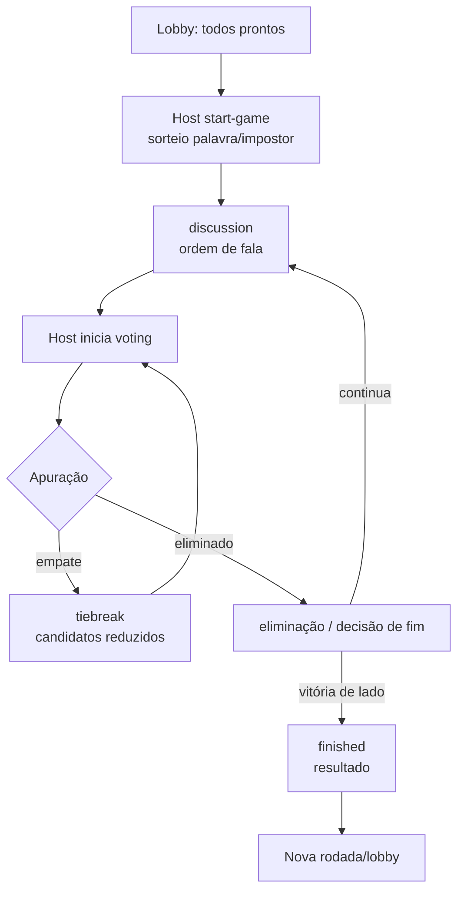
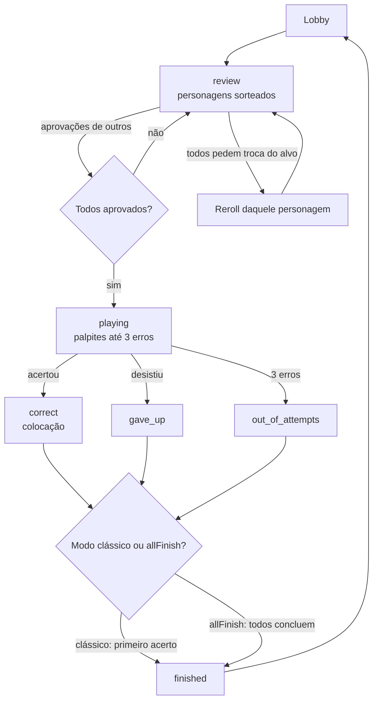
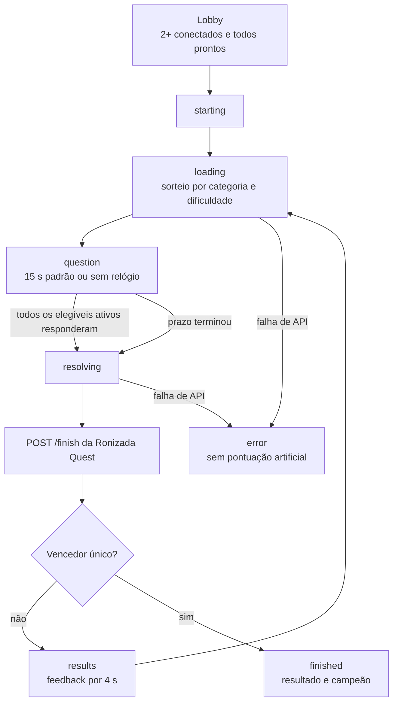

# 04 — ESPECIFICAÇÃO DE PRODUTO, REGRAS E MÁQUINAS DE ESTADOS

## 1. Padrão transversal a todas as modalidades

O usuário chega à biblioteca (`menu-screen`), seleciona jogo, visualiza tela de criação/entrada, informa identidade (ou usa conta), cria sala por código de quatro caracteres ou entra em uma sala, espera no lobby, marca *pronto*, host inicia somente após critérios do modo, o backend distribui o estado específico e a partida termina em tela/estado de resultado. Salas podem ser públicas ou protegidas por senha; usuários podem reconectar durante tolerância de **30 segundos**; espectadores são tratados separadamente. A sala ativa impede um mesmo token de ingressar simultaneamente em várias salas.

**Padrão entre telas:** biblioteca → home de modalidade → lobby → partida → resultado → novo lobby ou biblioteca. A interface usa a mesma janela retrô, identidade/avatares e componentes, diferenciando apenas controles particulares do jogo.

### Critérios de entrada e prontidão

| Jogo | Mínimo de participantes (`publicRoom` / start) | Para iniciar |
|---|---|---|
| Impostor | 3 | host + todos conectados/prontos; palavra sorteável |
| Quem Sou Eu? | 2 | host + todos conectados/prontos; personagens suficientes |
| Corrida do Conhecimento | 2 | host + todos conectados/prontos; filtros e API válidos |

## 2. Impostor

### Objetivo

Um participante é escolhido aleatoriamente como **impostor**; os demais recebem palavra secreta da rodada. O impostor recebe uma experiência/indicação diferente e deve disfarçar sua condição. O jogo usa categorias, dificuldade e dicas sem espaços; distribuição por Socket.IO é **personalizada por participante**, não broadcast de segredo.

### Estrutura dos dados da rodada (`room.currentRound`)

```text
id, startedAt, word, hint, impostorToken,
category, difficulty,
phase, speakingOrder, voteRound, vote,
tiebreakCandidates, lastVoteCounts,
votedOutToken, eliminatedTokens,
winnerSide, resultReason, winnerToken
```

### Fases e transições



### Regras verificadas no código

- Host só inicia com pelo menos 3 jogadores e todos prontos/conectados.
- Host só abre votação nas fases `discussion` ou `tiebreak`, sem membros desconectados.
- Voto exige candidato válido; **não votar em si mesmo** e **não votar duas vezes**.
- O backend resolve empates por fase específica, administra eliminados e determina `winnerSide`/`resultReason`.
- Cliente recebe progressos e resultado por eventos especializados.
- Estatísticas históricas de conta contemplam papel de impostor/investigador e vitórias.

**Para replicar resolução de vitória com exatidão:** portar `finishImpostorRound`, `startImpostorVote`, `resolveImpostorVoteIfReady`, `buildImpostorFinishedPayload` e os testes `impostor-vote.test.js` de `server.js`. Não substituir as condições por uma heurística genérica de “maioria”.

## 3. Quem Sou Eu?

### Objetivo

Cada participante recebe um **personagem distinto** do acervo do servidor, com nome e imagem; os demais podem ver o personagem associado ao jogador, mas o próprio jogador não deve recebê-lo antecipadamente na experiência normal. A modalidade utiliza categorias, dificuldade, imagens e uma **conferência colaborativa antes da rodada**. Existe opção `allFinish` (todos concluírem) além do formato clássico.

### Estados



### Revisão dos personagens

- `start-whoami-game` sorteia personagens e constrói: `assignments`, `assignmentIds`, `assignmentImages`, `playerStates`, `reviewVotes`, `approvedTargets`, `speakingOrder`.
- Cada jogador avalia o personagem **dos outros** como `approve` ou `reroll`; autoavaliação bloqueada.
- Um alvo só é aprovado com aprovação de todos os outros participantes elegíveis. Troca ocorre se todos os elegíveis solicitarem reroll; novo personagem exclui IDs já utilizados na sala.
- Após aprovar todos os alvos, emite `whoami-review-complete` e inicia fase de jogo.

### Palpites, quase acerto e fim

- Cada palpite é classificado por `classifyWhoAmIGuess` em `invalid`, `correct`, `close`, `wrong`.
- Palpite `close` **não consome tentativa**. Algoritmos de normalização canônica, Levenshtein e subconjuntos ordenados existem no servidor; portar esses utilitários e testes para manter tolerância a variantes de nomes.
- Palpite errado consome **uma de três tentativas**. Na terceira, `out_of_attempts` e participante eliminado.
- Acerto produz `placement`, anuncia o acerto e marca vencedor quando for o primeiro. No `allFinish`, acertos e eliminações prosseguem até todos concluírem; no clássico, primeiro acerto encerra a partida.
- `whoami-reveal-self` significa desistir e revelar o personagem, **sem consumir artificialmente tentativas restantes**.
- A interface apresenta personagens, cards com imagens e fallbacks, prévias flutuantes, avisos de palpites, tentativas, quadro de progresso e tela de vencedor.

### Imagens e catálogo

`whoami-images.js` decide provedores e aliases conforme categoria/contexto. O código utiliza IGDB, AniList, TMDB, TVMaze, Wikipedia/Wikidata/Commons. Não tratar a URL que o navegador exibiu como única fonte. Há fallbacks para imagens indisponíveis e controle de texto/HTML. Catálogo de personagens vem de `characters` + seed/migração; o usuário relatou 1.224 personagens em versão anterior, valor a validar na base viva.

## 4. Corrida do Conhecimento — especificação normativa da V20.20.4

### Criação de sala

- **24 categorias** carregadas por `/api/trivia/categories`, cada uma com `id` canônico, `name` visual e `available` (número aprovado).
- Tags são botões toggle: clicar seleciona, clicar novamente desmarca; há `Selecionar todas` e `Limpar`.
- Inicialmente selecionadas (se disponíveis): `Conhecimentos gerais`, `História`, `Geografia`, `Ciência e natureza` (mostra “Ciências”), `Cinema`, `Séries e televisão` (“Séries e TV”), `Anime e mangá`, `Videogames`, `Esportes`, `Música`, `Mitologia`, `Livros e literatura` (“Livros”).
- Dificuldade `random` (padrão), `easy`, `medium`, `hard`.
- `durationSeconds`: inteiro **0..30**, padrão **15**; **0 significa sem cronômetro**.
- Sala pode ser privada, com senha de 4 a 64 caracteres.
- Não é permitido criar sem categorias nem com filtros inválidos; servidor valida nomes reais e remove duplicações de forma defensiva.

### Fluxo de partida



### Regras concretas

1. **Uma pergunta simultânea** para todos; backend faz chamada `POST /api/v1/rounds` (chave service), envia enunciado, alternativas A-D (ou menos, se T/F) e prazo de acordo com o servidor Trivia.
2. Cada jogador envia `optionId` via evento `trivia-answer`; o backend determina `playerId` pelo `socket.data.playerToken` e chama `POST /rounds/{id}/answers`. Resposta irrevogável.
3. `round_answers` tem PK `(round_id,player_id)` e valida o prazo com `clock_timestamp()` no PostgreSQL. Não aceite timestamp enviado pelo navegador.
4. Backend encerra quando **todos os conectados e elegíveis** responderam ou quando `expiresAt` é atingido. O `setTimeout` local acrescenta ~350 ms de margem, mas a decisão sobre pontualidade pertence ao banco remoto.
5. `/finish` corrige só respostas realmente registradas antes do prazo. Ausentes **não avançam**.
6. Resposta correta: pontuação `min(10,score+1)`; errada ou não enviada: `+0`.
7. Sem vencedor: fase `results` por **4.000 ms**, em seguida rodada automática.
8. **Vencedor exclusivo** na casa 10: `finished`, tela de campeão com avatar, ranking final, número de rodadas e indicação de desempate, quando houver.
9. **Dois ou mais alcançam 10 na mesma rodada:** somente esses tornam-se finalistas e respondem a perguntas extras. Se só um acerta, vence; se vários acertam, apenas esses continuam; se nenhum acerta, repetem os mesmos finalistas. Torres permanecem 10/10.
10. O vencedor e a classificação vêm do estado servidor, não de cálculo navegador. A tela final é mostrada após pequeno intervalo (~1,7 segundo no cliente na versão V20.20.3).
11. Host pode reiniciar para lobby após vitória. Ao reiniciar: `cleanup`, reseta `ready`, promove espectadores quando pertinente, emite `trivia-back-to-lobby`.

### Escolha da pergunta

`trivia-race.js` embaralha categorias selecionadas, ordena para favorecer as menos utilizadas na partida (`categoryUses`), e tenta dificuldades em ordem embaralhada quando `random`. Para categoria/dificuldade sem pergunta, tenta outras combinações **apenas quando a API retorna conflito HTTP 409**. `roomId` da API inclui UUID gerado ao iniciar a corrida, o que previne repetição de `question_id` naquela mesma partida por constraint `UNIQUE(room_id,question_id)`.

### Acerto e pontuação entre usuários

O resultado remoto é mapeado por `playerId == playerToken`; `correctOptionId` só é revelado quando finaliza. O contador de resposta e a pontuação são atualizados por evento `trivia-state`. `trivia-my-state` permite que a UI continue bloqueando uma segunda resposta após reconexão.

### Limitações observadas — não esconder numa réplica

- Progresso Corrida está em memória no portal; ao reiniciar o servidor o estado da partida some.
- A tabela `match_history`/`getStats` do código analisado contabiliza modalidades clássicas; a Corrida **não tem estatística persistente de vitórias de conta equivalente** comprovada.
- Sem cronômetro depende de todos os participantes ativos responderem; desconexão/abandono exige tratamento para não travar a rodada.
- O acervo aprovado em lote pode conter erros de tradução ou gabarito; não tratar aprovação administrativa como revisão científica.

## 5. Regras de reaproveitamento obrigatório

Toda modalidade **precisa** usar: o mesmo `retro-window`, identidade (conta/visitante), avatar, modal de escolha, validação do host, privacidade, cópia de código, pronto/aguardando, reconexão, modo espectador e notificações. Somente telas e lógica internas devem diferir. Evitar recriar CSS local que sobrescreva tokens do site inteiro.
